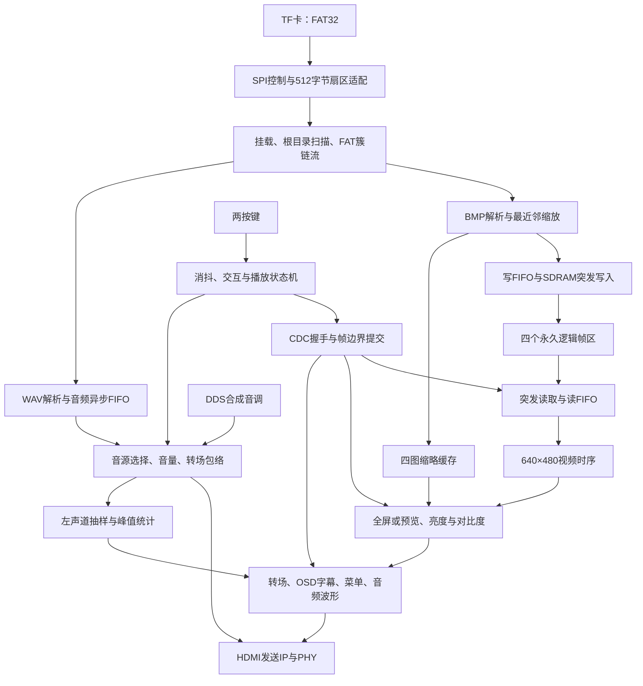

# 完赛工程技术总结（v9，第4～15讲融合）

整理日期：2026-10-23。工程目录：`D:\FPGA\lab_ex5_i2s`。

本工程是一套基于安路FPGA的多媒体图片播放器：从TF卡的FAT32文件系统读取BMP图片及可选WAV音频，完成图片缩放、四帧缓存、预览选择、图像调整、转场、字幕和音频波形叠加，通过HDMI输出画面与声音，使用两个按键操作。

本文按当前v9实际接入的功能整理。当前候选已完成软件回归、TD综合、布局布线和bit生成，**尚未完成本版实板验收**。工程目录中保留的历史实验模块，不代表全部参与当前顶层运行。

## 一、技术总览

| 技术方向 | 本工程使用的技术 | 实现的功能 |
|---|---|---|
| RTL数字系统 | Verilog、有限状态机、计数器、参数化、模块化连接 | 不依赖软核CPU或操作系统组织整机运行 |
| 时钟与复位 | PLL、多时钟域、上电延迟、异步置位/同步释放 | 协调SD、SDRAM、视频和HDMI串行时钟 |
| TF卡接口 | SPI协议、扇区读取、握手、超时检测 | 读取TF卡中的普通文件数据 |
| 文件系统 | FAT32挂载、目录匹配、簇链遍历 | 查找图片/音频，支持文件碎片化 |
| 图片解码 | BMP文件头解析、BGR到RGB、行填充处理 | 读取不同尺寸24位无压缩BMP |
| 图片缩放 | 整数最近邻、DDA商余数步进、行缓存 | 将输入图片归一到640×480 |
| 图像存储 | SDRAM四个逻辑帧区、突发传输、异步FIFO | 上电预载，运行时快速切换图片 |
| 跨时钟通信 | Gray指针、同步寄存器、请求/应答、帧边界提交 | 避免缓存、参数和视图切换出现不一致 |
| 视频输出 | 行场时序、RGB888、流式接口、HDMI发送IP和PHY | HDMI显示640×480彩色画面 |
| 图像处理 | 定点乘法、带符号运算、饱和、流水线 | 亮度/对比度调整，淡入淡出和擦除转场 |
| 图形叠加 | 字模ROM、坐标判断、计时、滚动字幕 | 图片号、播放状态、时间、参数和菜单 |
| 缩略图 | 采样降分辨率、RGB332、双时钟缓存 | 四图预览、焦点框、缺图占位 |
| 人机交互 | 按键消抖、长短按识别、分层状态机 | 翻图、轮播、预览、确认和参数设置 |
| 音频 | RIFF/WAV解析、PCM流、DDS音调、音量/包络 | WAV循环、无文件时合成音调、音画联动 |
| 音频可视化 | 时域抽样、双缓冲、峰值统计 | 显示最终输出左声道的波形和峰值条 |
| 工程验证 | 模型仿真、逐像素/逐样本对照、故障注入、STA | 验证功能、边界情况、资源及时序 |
| 配置启动 | JTAG SRAM下载、SPI Flash固化 | 临时调试和断电后自动加载FPGA配置 |

## 二、整机架构与数据流



图中表示功能关系。实际调度为：先扫描目录并预载所有可用图片，随后把SPI读卡通路交给WAV播放。换图直接读SDRAM，不再重新读取TF卡图片，因此播放音乐时无需与换图争抢图片读卡带宽。

## 三、时钟、复位与跨时钟域技术

### 1. 多时钟设计

| 时钟 | 频率 | 主要用途 |
|---|---:|---|
| 板级参考 | 50 MHz | PLL输入 |
| 系统/SD域 | 100 MHz | 文件读取、解析及系统控制 |
| SDRAM域 | 约41.666667 MHz | SDRAM控制，并使用相移输出时钟 |
| 像素域 | 25 MHz | 视频像素处理及音频输出节拍生成 |
| HDMI串行域 | 125 MHz | 配合PHY串行输出 |

640×480有效区对应800×525总时序，当前25 MHz像素时钟下，刷新率约为 **59.52 Hz**。它是常见的约60 Hz显示模式，不能把当前时钟计算结果写成精确60 Hz。

### 2. 冷启动与复位

上电逻辑先给PLL约1 ms确定复位，锁定后再等待约500 ms释放业务逻辑；各时钟域使用异步置位、同步释放复位。目的在于让时钟、SD卡和SDRAM初始化具有确定顺序，减少“烧Flash后必须按RST才运行”的问题。

### 3. CDC通信

- 大批量像素及PCM数据通过异步FIFO跨域；读写指针采用Gray编码并经同步级传递。
- 图片bank、图片号、有效标记和视图使用请求/应答提交，发送端保持数据稳定直到应答。
- 菜单设置使用稳定总线配合握手，在视频帧边界更新，避免半帧使用旧参数、半帧使用新参数。
- 复位与CDC既有RTL检查，也有路由网表结构审计；时序约束没有把全部跨域路径统一设为false path来掩盖问题。

关键源码：[reset_sync.v](D:/FPGA/lab_ex5_i2s/src/user_source/hdl_source/reset_sync.v)、[frame_commit_cdc.v](D:/FPGA/lab_ex5_i2s/src/user_source/hdl_source/frame_commit_cdc.v)、[media_settings_cdc.v](D:/FPGA/lab_ex5_i2s/src/user_source/hdl_source/display/media_settings_cdc.v)。

## 四、TF卡SPI与FAT32文件系统

### 1. 扇区与流控

底层通过SPI访问TF卡，每扇区512字节。扇区适配层检查长度、完成状态和超时；上层按缓冲余量允许下一扇区进入。当前应用只读卡，不写配置文件。原SPI读通路没有新增数据CRC16验证，不能宣传为已实现完整CRC校验。

### 2. FAT32读取

支持MBR分区及无分区表的FAT32卷布局，解析卷参数、处理活动FAT、扫描根目录中的8.3短文件名，并沿FAT簇链读取文件。文件不必连续分配，因此可以在电脑上普通复制文件，不需要写旧裸盘镜像。

```text
TF卡根目录
├─ PIC1.BMP
├─ PIC2.BMP
├─ PIC3.BMP
├─ PIC4.BMP
└─ AUDIO.WAV    可选
```

系统只识别这四个图片编号，缺图或坏图跳过并保留其原编号。支持碎片簇链，检查越界、循环、提前结束及文件末尾FAT错误。只有图片解析成功且SDRAM写入真正完成后，才发布有效标记。

关键源码：[sd_sector_adapter.v](D:/FPGA/lab_ex5_i2s/src/user_source/hdl_source/SD/sd_sector_adapter.v)、[fat32_volume_scanner.v](D:/FPGA/lab_ex5_i2s/src/user_source/hdl_source/SD/fat32_volume_scanner.v)、[fat32_file_streamer.v](D:/FPGA/lab_ex5_i2s/src/user_source/hdl_source/SD/fat32_file_streamer.v)。

## 五、BMP解析与最近邻缩放

### 1. BMP解析

支持24位无压缩、正高度bottom-up BMP；验证签名、尺寸、位深、压缩类型、像素偏移和文件范围，处理BGR存储顺序、每行4字节对齐以及上下方向。

输入宽高分别允许1～2048，文件不超过16 MiB，像素数据偏移54～4096字节。文件后缀必须对应真实BMP格式，不能通过把JPG改名为BMP使用。

### 2. 整数最近邻缩放

所有合规图片预先缩放为640×480，采样坐标为：

```text
source_x = floor(output_x × input_width  / 640)
source_y = floor(output_y × input_height / 480)
```

使用整数商余数累加的DDA步进，避免逐像素浮点运算和复杂实时除法。通过2048×24位行缓存重用源行，并以1024×8位弹性FIFO吸收扇区输入；启动下一不可暂停扇区前预留空间。缓存使用同步BRAM读写，降低LUT消耗。

当前采用拉伸填满，输入宽高比与4:3不同会变形；最近邻放大会呈现像素块。双线性插值和等比例黑边尚未实现。

关键源码：[fat32_bmp_reader.v](D:/FPGA/lab_ex5_i2s/src/user_source/hdl_source/SD/fat32_bmp_reader.v)、[bmp_nearest_scaler.v](D:/FPGA/lab_ex5_i2s/src/user_source/hdl_source/SD/bmp_nearest_scaler.v)。

## 六、四bank SDRAM帧缓存

这里的“四bank”是四个固定的**逻辑图片帧区**，不等同于SDRAM芯片内部物理bank数量。

| 参数 | 当前实现 |
|---|---|
| 图片帧区 | 4个，上电预载后保留 |
| 每图分辨率 | 640×480 |
| 像素有效颜色 | RGB888 |
| SDRAM存储字 | 32位，RGB位于[31:8]，低8位填0 |
| 单帧容量 | 307,200个32位字，即1,228,800字节 |
| 四帧容量 | 4,915,200字节，约4.6875 MiB |
| 突发长度 | 128个32位字 |
| 读/写异步FIFO | 各512个32位字 |

写入端把解析、缩放后的像素经FIFO送至SDRAM；读取端把突发数据转换成连续视频像素。两类节拍通过FIFO解耦，独立控制器负责读写调度、地址、清空、超时与下溢/溢出诊断。

切换图片时提交目标帧区，手动转场在黑屏阶段完成切换及应答后再淡入，避免旧帧尾部和新帧头部混杂。有效bank发布同时要求文件读取成功和SDRAM写入排空完成，兼容两者不同的先后顺序。

四bank方案当前最多缓存四张图。若增加PIC5及以上，现版本会忽略；要支持更多图片，必须增加文件调度和替换/预取策略，不能仅多复制文件。

关键源码：[media_frame_loader.v](D:/FPGA/lab_ex5_i2s/src/user_source/hdl_source/SD/media_frame_loader.v)、[media_frame_reader.v](D:/FPGA/lab_ex5_i2s/src/user_source/hdl_source/SD/media_frame_reader.v)、[media_player_control.v](D:/FPGA/lab_ex5_i2s/src/user_source/hdl_source/SD/media_player_control.v)。

## 七、视频流水线与HDMI输出

视频主链完成RGB读取、预览替换、亮度/对比度、转场与字幕、菜单、波形叠加，再封装为带有效、帧起始SOF、行结束EOL标记的视频流，送入HDMI发送IP和PHY。

各处理级同步延迟RGB、DE和行场相关信号，保证字符、焦点、波形与实际像素对齐。HDMI发送端使用厂商加密IP，结合PHY完成编码、串行输出及音频封包；当前不能把整条HDMI协议栈称为完全自研。

保留DDC/I²C与EDID读取连接，但输出固定640×480，没有根据EDID自动切换分辨率。当前声音通过HDMI输出，工程名虽然含i2s，当前主链并没有新增直接I2S音频输出接口。

关键源码：[top_tf_hdmi_audio.v](D:/FPGA/lab_ex5_i2s/src/user_source/hdl_source/top_tf_hdmi_audio.v)、[video_rgb_to_axis_640x480.v](D:/FPGA/lab_ex5_i2s/src/user_source/hdl_source/video_rgb_to_axis_640x480.v)、[hdmi_phy_warpper.v](D:/FPGA/lab_ex5_i2s/src/user_source/hdl_source/hdmi_phy_warpper.v)。

## 八、图像处理、转场与OSD

### 1. 亮度和对比度

RGB三通道独立进行定点运算：先调整亮度，再以128为中心调整对比度，最后饱和到0～255。

```text
B=255：亮度级精确旁路；其他B：pixel × B / 256，按RTL截断
对比度：(亮度级输出 - 128) × C / 128 + 128，按RTL有符号移位并饱和
B=255、C=128：精确保持原始RGB
```

使用DSP乘法与流水线保证处理速率，避免有符号数处理错误或溢出回卷。C=0得到中灰，B=0且C=128得到黑色，均为设计行为。菜单和文字在图像调整之后叠加，图像调暗时仍可操作。

### 2. 转场

- 手动翻图和预览确认：16帧淡出→黑屏提交新帧区/视图→16帧淡入，音频同步按alpha包络衰减和恢复。
- 自动轮播：从左向右擦除，每帧推进40像素；音频不随擦除列位置改变。

### 3. OSD与字幕

采用字模ROM、像素坐标判断与帧计数，实现图片编号、自动/手动状态、错误提示、MM:SS运行时间、底部滚动ASCII“FPGA PLAYER”和动态参数。文字绘制与转场组合形成流水线，不要求CPU逐像素绘制。

关键源码：[brightness_contrast_adjust.v](D:/FPGA/lab_ex5_i2s/src/user_source/hdl_source/display/brightness_contrast_adjust.v)、[video_effects_pipeline.v](D:/FPGA/lab_ex5_i2s/src/user_source/hdl_source/display/video_effects_pipeline.v)、[video_transition_commit.v](D:/FPGA/lab_ex5_i2s/src/user_source/hdl_source/display/video_transition_commit.v)。

## 九、四图预览与两键交互

缩略图在预载期间生成，每图80×40、RGB332，四图合计12,800字节。显示时每点扩展为2×3像素，使每格达到160×120，四格组成左上角320×240区域；使用2像素黄色焦点框和缺图灰色占位。完整标记防止旧RAM内容被误显示为有效缩略图。**全屏仍为RGB888**，预览降低颜色精度用于节省片上RAM。

按键消抖约20 ms，长按门限约1 s。KEY1长按达到门限触发一次；KEY2长按在松开后触发。状态机区分全屏、预览和菜单，预载或特定切换忙期间限制操作，自动轮播在预览/菜单暂停。

| 模式 | KEY1短按/长按 | KEY2短按 | KEY2长按后松开 |
|---|---|---|---|
| 全屏 | 下一张/上一张 | 开关自动轮播 | 进入预览 |
| 预览 | 焦点后移/前移 | 确认有效图片 | 进入菜单 |
| 菜单 | 参数升档/降档 | 切换B/C/V/P字段 | 返回原全屏图片 |

| 菜单字段 | 技术含义 | 默认值 | 可调档位 |
|---|---|---|---|
| B | 亮度系数 | FF=255 | 0、64、128、192、255 |
| C | 对比度系数 | 80=128 | 0、64、128、192、255 |
| V | 音量系数 | 60=96 | 调节进入0、64、128、192、255 |
| P | 自动轮播等待秒数 | 03=3秒 | 2、3、5、10、30秒 |

菜单数值采用两位十六进制，如0A=10、1E=30。设置通过CDC在帧边界更新，RST或掉电恢复默认，不写Flash保存。P表示转场之间的等待时间，实际换图间隔还包含转场耗时。

关键源码：[thumbnail_cache.v](D:/FPGA/lab_ex5_i2s/src/user_source/hdl_source/display/thumbnail_cache.v)、[media_ui_controller.v](D:/FPGA/lab_ex5_i2s/src/user_source/hdl_source/SD/media_ui_controller.v)、[media_menu_overlay.v](D:/FPGA/lab_ex5_i2s/src/user_source/hdl_source/display/media_menu_overlay.v)。

## 十、音频播放、合成与音画同步

### 1. WAV文件流播放

解析RIFF/WAVE的chunk结构，查找fmt与data，跳过JUNK/LIST等未知块，处理奇数字节填充、跨扇区头部和长度边界。支持PCM format=1、48 kHz、16位有符号小端、单/双声道、文件≤16 MiB；单声道复制为左右声道，播放结束循环。

音频采用4096×32位异步BRAM FIFO，每个32位条目包含左右两个16位样本；容量16 KiB，相当于约85.3 ms的48 kHz立体声音频。起播水位256帧约5.33 ms，按FIFO水位暂停下一扇区请求。下溢时输出零并保持采样节拍，格式或读卡错误时回退合成音调。

### 2. DDS合成音调

没有AUDIO.WAV时，采用分数累加生成48 kHz采样节拍，使用20位相位累加器和16点正弦表合成音调。按图片编号选择四组六音琶音，每音约250 ms，并提供约1.5 kHz、100 ms的切图提示。

### 3. 音量和转场包络

WAV使用动态V音量和alpha包络，255映射为精确满增益；有符号乘法、截断和有效信号同步经过验证。合成音调已在音源端调音量，后级避免重复乘V。HDMI以音频样本封包与ACR时钟恢复机制传输，使用N=6144；16位PCM在接口处左对齐到24位字，不代表支持24位WAV输入。

关键源码：[wav_pcm_decoder.v](D:/FPGA/lab_ex5_i2s/src/user_source/hdl_source/audio/wav_pcm_decoder.v)、[fat32_wav_player.v](D:/FPGA/lab_ex5_i2s/src/user_source/hdl_source/audio/fat32_wav_player.v)、[pcm_async_fifo.v](D:/FPGA/lab_ex5_i2s/src/user_source/hdl_source/audio/pcm_async_fifo.v)、[pcm_media_tone.v](D:/FPGA/lab_ex5_i2s/src/user_source/hdl_source/pcm_media_tone.v)、[pcm_fade_output.v](D:/FPGA/lab_ex5_i2s/src/user_source/hdl_source/audio/pcm_fade_output.v)。

## 十一、音频时域波形和峰值显示

取最终音量及转场包络之后的**左声道PCM**，每12个样本抽1点，共32点，对应约8 ms窗口。通过双缓冲在帧边界交换数据，绘制波形和峰值条。静音时波形趋于中线，声音幅度增大时波形和峰值相应变化。

波形区域x=64～575、y=368～431；峰值条x=584～591。左侧小色块表示音频状态：黄为合成音调/尚未起播，绿为WAV，橙为曾经下溢，红为音频错误；橙红诊断保持到RST。

本功能是**时域波形显示，不是FFT频谱分析**，没有频率分箱、频谱柱状图或FFT核。仅右声道有声音时，左声道波形可能不明显。

关键源码：[audio_visualizer.v](D:/FPGA/lab_ex5_i2s/src/user_source/hdl_source/display/audio_visualizer.v)、[promax_audio_waveform.v](D:/FPGA/lab_ex5_i2s/src/user_source/hdl_source/display/promax_audio_waveform.v)。

## 十二、诊断、验证和工程实现

### 1. 运行诊断

数码管及OSD反映初始化、图片编号和错误信息。检查覆盖文件格式、FAT簇链、扇区长度/超时、SDRAM写入、读超时和视频下溢等，便于区分“文件准备错误”和“数据链路故障”。判断故障应记录完整数码管，不能只凭末尾60或80推断全部原因。

### 2. 验证方法

- 使用WSL中的Icarus Verilog执行RTL仿真，以SD扇区模型和SDRAM接口边界模型驱动系统。
- 对缩放、预览、菜单、OSD和转场做整帧逐像素对照，对音频做逐样本及增益组合对照。
- 覆盖碎片文件、缺图、非法格式、奇数chunk、读卡错误、超时、FIFO回卷、下溢及运行中复位。
- 在TD中执行综合、优化、布局布线、Slow/Fast静态时序分析和bit生成，并核对源码登记、约束和候选哈希。

已有记录包括22个FAT32场景、21类WAV场景加复位、7种尺寸缩放、917,504组动态PCM增益组合以及预览/菜单整帧测试。上述为软件证据；真实TF卡、电源、HDMI电气与听音、Flash冷启动仍以实板结果为准。

### 3. 当前候选资源与时序

器件EG4S20BG256，工具TD 6.2.168116，数据来自2026-10-23最终候选构建。

| 项目 | 使用/总量 | 约占比 |
|---|---:|---:|
| LUT | 15,228 / 19,600 | 77.7% |
| 寄存器 | 9,382 / 19,600 | 47.9% |
| BRAM9K | 58 / 64 | 90.6% |
| DSP | 19 / 29 | 65.5% |
| PLL | 2 / 4 | 50.0% |

Slow/Fast两角路由setup最差余量SWNS=+0.103 ns、STNS=0，hold最差余量HWNS=+0.011 ns、HTNS=0，STA覆盖率99.99%。片上RAM余量较小，因此采用RGB332缩略图和同步BRAM缓存；轮播周期使用预译码阈值，避免实时乘法成为关键路径。

原厂SDRAM位置调整、SDRAM时钟局部走线和加密IP相关告警仍保留；外部IO延迟缺完整实测约束。不能把当前结果表述为零告警或已完成板级时序签核。

### 4. 下载和启动技术

PROGRAM_SRAM通过JTAG临时配置，断电失效；PROGRAM_FLASH将同一bit写入启动Flash U39地址0，断电后由板卡加载。VERIFY_FLASH为可省略的校验步骤，不负责启动应用。

**固化的是FPGA硬件配置，菜单参数不会因此掉电保存。** 本版还需按现有测试文档完成至少10次无需RST的断电冷启动与30～60分钟稳定性测试，再标记为本板验收版本。

## 十三、实现范围与可用于答辩的表述

可以将工程概括为：

> 本项目基于安路FPGA，采用RTL状态机实现TF卡FAT32文件读取和BMP/WAV解析，以最近邻缩放、四帧SDRAM缓存和跨时钟FIFO构建多媒体数据通路，结合图像流水线、OSD、转场、音频波形及两键菜单，通过厂商HDMI IP完成音视频输出，并使用模型仿真、整帧对照和静态时序分析进行验证。

重点可介绍四个设计问题：

1. **如何兼容普通文件复制：** 从固定裸扇区读取扩展为FAT32目录与碎片簇链读取。
2. **如何让换图不重新读卡：** 上电预载四个固定帧区，运行时提交bank，同时把读卡通路留给WAV。
3. **如何避免混帧和参数撕裂：** 异步FIFO传数据，握手传稳定设置，在帧边界提交显示状态。
4. **如何在资源约束下融合功能：** 同步BRAM、定点流水、RGB332缩略图及预译码计时，平衡功能、容量和时序。

系统集成、文件解析、调度、UI及图像/音频处理逻辑与厂商PLL、SDRAM和加密HDMI IP共同构成工程，应如实区分贡献。当前未接入软核CPU、操作系统、网络、摄像头、JPEG/PNG直接解码、MP3、双线性缩放、FFT、更多图片分页、参数Flash保存或独立I2S输出。

## 十四、工程与操作资料入口

- [当前TD工程](D:/FPGA/lab_ex5_i2s/src/td_project_media_v9/HDMI1.4b_Transmitter_v1.0.al)：顶层top；旧入口缺少当前新增模块登记。
- [全功能使用、素材准备、测试指令和Flash步骤](D:/FPGA/lab_ex5_i2s/doc/第十三至十五讲融合与全功能使用测试.md)。
- [候选构建记录](D:/FPGA/lab_ex5_i2s/release/media_v9_candidate_20261023/BUILD_INFO.md)。
- [全功能软件回归脚本](D:/FPGA/lab_ex5_i2s/verification/media_v9/verify_all.ps1)。

本次仅整理技术文档，不修改RTL、下载文件或历史候选包。
